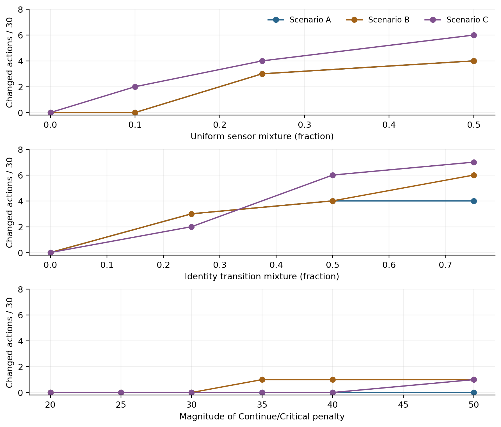

<!-- title-block -->
# Biogas Plant Intelligent Monitoring and Decision System

Unit: COMP6009

Assignment Part B

Student name: Sayuru Bopitiya

Student ID: 24071158

Date: 26 October 2026
<!-- /title-block -->

## 1. Introduction and problem formulation

An anaerobic digester at a Western Australian red-meat processing facility converts organic waste into useful biogas. Variable waste composition and loading can make its condition difficult to assess. Operators observe sensor readings, while the underlying biological state remains hidden. A warning therefore provides evidence of a problem rather than establishing that the digester is stressed with certainty.

This system represents the hidden state as Stable, Stressed or Critical, and Sensor 1 observations as Normal, Warning or Alarm. Its purpose is to maintain a probability distribution over the states and recommend Continue, Reduce Feed or Intervene. The supplied probability and utility tables define the baseline model [1]. Bayesian inference first investigates individual and combined observations. Hidden Markov Model (HMM) filtering then tracks condition across three 30-step sequences. Finally, expected utility converts each belief distribution into an operational recommendation. A useful agent must balance maintaining energy production against responding early enough to potentially damaging conditions, while making the basis of each recommendation understandable. The analysis evaluates inference and decision behaviour; the supplied datasets contain no measured hidden states or outcomes with which to establish real-world accuracy.

## 2. Probabilistic modelling and Bayesian inference

The priors for Stable, Stressed and Critical are 0.70, 0.20 and 0.10. I interpret Stable as steady methane yield and normal pH; Stressed as early signs such as rising volatile fatty acids or drifting pH; and Critical as acidification or process-failure risk. These illustrative digester descriptions are my interpretation, not definitions supplied by the brief; literature informs their biological context [5], [6].

Bayesian updating multiplies priors by likelihoods and normalises. Conditional independence permits multiplying sensor likelihoods. Python accepts valid observation-model pairs, rejecting invalid tables, unknown observations and zero-probability evidence. P(Alarm | Critical) = 0.70 is a likelihood, not a 70% Critical posterior.

$$P(x\mid e_1,e_2)=\frac{P(x)P(e_1\mid x)P(e_2\mid x)}{\sum_y P(y)P(e_1\mid y)P(e_2\mid y)}$$

Table 1 reports the single-sensor and combined-sensor posteriors. The state order is Stable, Stressed, Critical.

| Evidence | Stable | Stressed | Critical |
| --- | ---: | ---: | ---: |
| Normal | 0.910569 | 0.081301 | 0.008130 |
| Warning | 0.420000 | 0.480000 | 0.100000 |
| Alarm | 0.259259 | 0.222222 | 0.518519 |
| Warning + Abnormal pH | 0.114441 | 0.653951 | 0.231608 |

*Table 1. Computed posterior probabilities; displayed values are rounded.*

A Normal reading supports Stable. Warning favours Stressed at 0.48. Alarm assigns Critical 0.518519: roughly half the model's belief lies on acidification or failure risk, warranting investigation of loading and independent pH checks. Almost half remains on other states; an operator should assess uncertainty and action consequences rather than treat Alarm as proof of failure. These are model-based beliefs, not measured failure frequencies; validating them requires operating records with independently assessed digester conditions.

For the manual combined-evidence calculation, the unnormalised weights are shown in Table 2. Their sum is Z = 0.01050 + 0.06000 + 0.02125 = 0.09175. Dividing each weight by Z gives (0.114441, 0.653951, 0.231608), agreeing with Python to the displayed precision. Warning alone similarly gives weights (0.105, 0.120, 0.025), Z = 0.250, and posterior (0.420, 0.480, 0.100).

| State | Prior × Warning likelihood × Abnormal pH likelihood | Weight |
| --- | --- | ---: |
| Stable | 0.70 × 0.15 × 0.10 | 0.01050 |
| Stressed | 0.20 × 0.60 × 0.50 | 0.06000 |
| Critical | 0.10 × 0.25 × 0.85 | 0.02125 |

*Table 2. Manual Bayesian calculation for Warning and Abnormal pH.*

Adding Abnormal pH reduces Stable by 30.56 percentage points and increases Stressed and Critical by 17.40 and 13.16 points because abnormal pH favours these states under the supplied model.

At a red-meat processing digester, variable fat/protein loading and ammonia inhibition challenge fixed likelihoods [5], [6]. Protein degradation can release ammonia, disrupting methane production [5]. pH probe fouling or drift can distort observations [6]. Shared probes or disturbances could correlate sensor errors even given the state, breaking conditional independence: multiplying likelihoods would double-count evidence. A joint sensor model and plant-specific calibration are needed. Three categories also compress the biochemical and physicochemical processes represented in mechanistic models [4].

## 3. HMM-based state estimation

HMM filtering estimates P(X_t | e_1:t) from available observations. It predicts through the transition model, incorporates the likelihood, and normalises. This is forward filtering, not retrospective smoothing or complete-sequence decoding [3]. Transition rows represent current states and columns next states; diagonal probabilities 0.80, 0.60 and 0.65 encode persistence.

$$\hat b_t(x)=\sum_y b_{t-1}(y)T_{yx},\quad w_t(x)=\hat b_t(x)P(e_t\mid x),\quad b_t(x)=\frac{w_t(x)}{\sum_y w_t(y)}$$

The first observation updates the prior directly, without a preceding transition. Thus the first Normal observation gives (0.910569, 0.081301, 0.008130). Transitions begin at step 2. Scenarios restart from the same prior; pH is excluded. Outputs record prediction, unnormalised weights, normalising constant, posterior and most probable state.

At A's second Normal reading, predicted Stable is approximately 0.910569(0.80) + 0.081301(0.25) + 0.008130(0.05) = 0.749187. Table 3 shows the calculation. The weights sum to Z = 0.654915; dividing each by Z gives posterior (0.915157, 0.082118, 0.002725). Precision is retained.

| State | Previous | Prediction | Likelihood | Weight | Posterior |
| --- | ---: | ---: | ---: | ---: | ---: |
| Stable | 0.910569 | 0.749187 | 0.800000 | 0.599350 | 0.915157 |
| Stressed | 0.081301 | 0.215122 | 0.250000 | 0.053780 | 0.082118 |
| Critical | 0.008130 | 0.035691 | 0.050000 | 0.001785 | 0.002725 |

*Table 3. Worked HMM update at A, t=2. Previous and final beliefs each sum to one before display rounding.*

Table 3a compares the scenarios. Appendix D lists every step.

<!-- generated:comparison:start -->

| Scenario | Observed N / W / A | Most probable S / St / C | Peak P(Critical) | Peak t | Final posterior S / St / C |
| --- | --- | --- | --- | --- | --- |
| A | 26 / 3 / 1 | 27 / 3 / 0 | 0.243657 | 20 | 0.910045 / 0.087120 / 0.002835 |
| B | 12 / 13 / 5 | 12 / 13 / 5 | 0.720487 | 23 | 0.150819 / 0.745404 / 0.103777 |
| C | 15 / 10 / 5 | 14 / 12 / 4 | 0.871110 | 25 | 0.350838 / 0.596407 / 0.052755 |

*Table 3a. Generated scenario comparison. N/W/A = Normal/Warning/Alarm; S/St/C = Stable/Stressed/Critical. Peak ties select the earliest step. Probabilities are rounded to six decimals.*

<!-- generated:comparison:end -->

### Scenario A: stable operation

*Figure 1. Scenario A beliefs and observed Sensor 1 labels over all 30 steps. The thin MAP strip marks the most probable posterior state, not ground truth; colours match the belief curves.*

At step 5, Stable is 0.916030. The Warning at step 6 moves the belief to (0.452441, 0.515390, 0.032169): Stressed becomes most likely, but the preceding normal history keeps Critical low. Normal at step 7 restores Stable to 0.788846. At step 20, Alarm raises Critical from 0.002446 to 0.243657. Stable nevertheless remains the most likely state at 0.407852 because the preceding belief strongly favoured it. Normal at step 21 raises Stable to 0.773248.

### Scenario B: deteriorating operation

*Figure 2. Scenario B beliefs; accumulated Warning and Alarm evidence increases concern. The MAP strip marks the most probable posterior state at every step.*

Warnings from steps 11 to 14 increase Stressed from 0.579738 to 0.770273, indicating accumulating evidence rather than an isolated disturbance. Alarm at step 15 then raises Critical to 0.596112, compared with only 0.243657 after A's step-20 Alarm. The preceding stressed belief explains this. Across steps 21 to 23, Alarm, Warning, Alarm produces Critical probabilities 0.665594, 0.323684 and 0.720487. The intervening Warning lowers immediate critical concern without restoring confidence in stability. At step 30, Stressed remains dominant at 0.745404. The sequence therefore supports persistent concern, although its fluctuations do not establish uninterrupted deterioration.

### Scenario C: noisy monitoring

*Figure 3. Scenario C beliefs; alternating readings and an Alarm cluster produce abrupt changes. The MAP strip marks the most probable posterior state at every step.*

At steps 4 and 5, Warning followed by Alarm increases Critical from 0.032197 to 0.470070. Warning at step 6 makes Stressed dominant at 0.650035, while retaining 0.250744 on Critical; Normal at step 7 restores Stable to 0.603187. Consecutive Alarms at steps 23 to 25 raise Critical from 0.555983 to 0.871110. Normal readings at steps 26 and 27 reduce it to 0.163725 and 0.020711. The noisy scenario has the highest critical peak; scenario names cannot substitute for evidence or ground truth.

A mainly shows short departures from stability; B accumulates evidence of stress; C changes sharply and can briefly appear more critical than B. Identical observation labels can yield different posteriors because their preceding beliefs differ.

The first-order, time-homogeneous HMM omits feed history and delays between loading changes and sensor response. Variable fat/protein inputs and ammonia inhibition challenge fixed transitions [5], [6]. Conditional observation independence also misses persistent pH probe fouling/drift [6], potentially mistaking correlated errors for sustained deterioration. Without a sampling interval, transitions apply per supplied step, not per hour or day.

## 4. Expected-utility decision making

The decision function calculates each action's probability-weighted utility and selects the largest value, following decision theory [2, ch. 16]. It uses the full posterior, so a less probable but costly state can influence the recommendation. Utilities are dimensionless scores rather than measured financial returns. Exact ties follow the supplied action order.

$$EU(a\mid b_t)=\sum_x b_t(x)U(a,x),\qquad a_t^*=\arg\max_a EU(a\mid b_t)$$

*Figure 4. All 90 baseline recommendations: C = Continue, R = Reduce Feed, I = Intervene.*

| Scenario | Continue | Reduce Feed | Intervene | Action changes |
| --- | ---: | ---: | ---: | ---: |
| A | 26 | 4 | 0 | 8 |
| B | 11 | 11 | 8 | 13 |
| C | 14 | 10 | 6 | 20 |

*Table 4. Baseline action counts and changes between consecutive recommendations.*

Table 5 highlights three decision points. At A's step 20, Continue has expected utility 10b(Stable) + 2b(Stressed) - 20b(Critical) = -0.097630, using full-precision values before rounding. Reduce Feed gives 2.911923 and Intervene gives 1.363317. Reduce Feed therefore wins although Stable is most probable. The potential loss from continuing under Critical outweighs the benefit of treating the most likely state alone.

| Point | Belief: Stable / Stressed / Critical | EU Continue | EU Reduce | EU Intervene | Choice |
| --- | --- | ---: | ---: | ---: | --- |
| A, t=20 | .407852 / .348491 / .243657 | -0.097630 | 2.911923 | 1.363317 | Reduce Feed |
| B, t=15 | .063245 / .340643 / .596112 | -10.608499 | -0.620476 | 5.537843 | Intervene |
| B, t=22 | .059944 / .616372 / .323684 | -4.641497 | 2.379531 | 4.198812 | Intervene |

*Table 5. Selected beliefs and expected utilities; calculations use unrounded posteriors.*

At B's step 15, Critical becomes dominant and intervention has a clear utility advantage. At step 22, Stressed is most likely, yet Intervene still wins because Critical retains 0.323684 probability after earlier alarms. A simple Stable/Continue, Stressed/Reduce Feed, Critical/Intervene lookup would disagree with expected utility at one step in A, four in B and two in C. It discards uncertainty that remains relevant to the consequences of an action.

Decision strength also matters. At B's step 16, Reduce Feed scores 4.520862 versus Continue's 4.274988: a margin of 0.245874. This is a close utility comparison, not a probability that the action is correct. Before acting, an operator should read the recommendation together with the belief and expected utilities. A narrow margin warrants checking whether intervention costs and failure consequences represent the plant. A wider margin indicates stronger preference under the model, while remaining dependent on its assumptions; neither margin establishes that the selected action will improve the biological process.

The recommendations also reveal operational trade-offs. A favours throughput during normal evidence while temporarily reducing feed during concern. B recommends intervention on eight steps. C changes actions 20 times, which could be disruptive if recommendations directly controlled equipment. Switching costs or minimum action durations could reduce oscillation, but would require a different decision model and careful evaluation of delayed responses.

The baseline assumes fixed utilities and optimises only immediate expected value. Real intervention costs, shutdown consequences and recovery times may vary. Importantly, actions do not alter the supplied transition model. Consequently, a Normal observation following Intervene cannot demonstrate that intervention caused recovery. Evaluating a control policy would require action-dependent transitions, a longer planning horizon and observed outcomes.

Appendix C examines sensitivity to modelling choices and compares each scenario's closest decisions.

## 5. Conclusion

The system connects uncertain observations, sequential belief estimation and operational choice. Warning alone gives 0.48 probability to Stressed; adding Abnormal pH raises it to 0.653951. HMM filtering preserves history, explaining different responses to identical observation labels. The baseline favours Continue in A, more intervention in B, and frequent switching in C.

Expected utility incorporates costly alternatives that a most-probable-state lookup discards. The A and B decisions demonstrate that estimating condition and selecting a response are separate tasks: the preferred response depends on both uncertain condition and the consequences assigned to available actions. Recommendations should therefore be presented alongside beliefs, rather than replacing them. Margins distinguish close choices from decisive comparisons, while sweeps and switching thresholds expose dependence on modelling assumptions. The worked calculations and automated audits make the numerical reasoning reproducible and check report consistency.

Mathematical correctness does not establish biological calibration or beneficial control. Deployment would require independently assessed operating records, investigation of sensor dependence, plant-specific utility estimates, and action-dependent dynamics. Within those limits, the approach provides an interpretable foundation for decision support: it records both the uncertainty about condition and the consequences underlying each recommendation.

## References

[1] COMP6009, "Assignment Part B: Biogas Plant Intelligent Monitoring and Decision System," supplied assignment brief and scenario datasets, undated.

[2] S. Russell and P. Norvig, Artificial Intelligence: A Modern Approach, 4th ed. Pearson, 2021, ch. 16, "Making Simple Decisions."

[3] L. R. Rabiner, "A tutorial on hidden Markov models and selected applications in speech recognition," Proceedings of the IEEE, vol. 77, no. 2, pp. 257-286, Feb. 1989, doi: 10.1109/5.18626.

[4] D. J. Batstone et al., "The IWA Anaerobic Digestion Model No 1 (ADM1)," Water Science and Technology, vol. 45, no. 10, pp. 65-73, 2002, doi: 10.2166/wst.2002.0292.

[5] Y. Chen, J. J. Cheng, and K. S. Creamer, "Inhibition of anaerobic digestion process: A review," Bioresource Technology, vol. 99, no. 10, pp. 4044-4064, Jul. 2008, doi: 10.1016/j.biortech.2007.01.057.

[6] T. Schmidt, B. McCabe, and P. Harris, "Process monitoring and control for an anaerobic covered lagoon treating abattoir wastewater," Chemical Engineering & Technology, vol. 41, no. 4, pp. 755-760, 2018, doi: 10.1002/ceat.201700391.

## Appendix A. Baseline model tables

The following tables reproduce the supplied models [1]. Probability rows sum to one. Transition rows refer to current state and columns to next state. Utility rows refer to action and columns to true state.

| True state | Prior | Sensor 1: Normal | Warning | Alarm |
| --- | ---: | ---: | ---: | ---: |
| Stable | 0.70 | 0.80 | 0.15 | 0.05 |
| Stressed | 0.20 | 0.25 | 0.60 | 0.15 |
| Critical | 0.10 | 0.05 | 0.25 | 0.70 |

| True state | Sensor 2: Normal pH | Abnormal pH |
| --- | ---: | ---: |
| Stable | 0.90 | 0.10 |
| Stressed | 0.50 | 0.50 |
| Critical | 0.15 | 0.85 |

| Current → Next | Stable | Stressed | Critical |
| --- | ---: | ---: | ---: |
| Stable | 0.80 | 0.18 | 0.02 |
| Stressed | 0.25 | 0.60 | 0.15 |
| Critical | 0.05 | 0.30 | 0.65 |

| Action | Stable | Stressed | Critical |
| --- | ---: | ---: | ---: |
| Continue | +10 | +2 | -20 |
| Reduce Feed | +5 | +6 | -5 |
| Intervene | -4 | +3 | +8 |

## Appendix B. Additional expected-utility plots

*Figure B1. All three actions' expected utilities over every time step; the highest curve determines the recommendation.*

## Appendix C. Decision robustness and full sensitivity sweeps

### Sensitivity to modelling choices

Separate sweeps retain the observations and prior. Sensor likelihoods become (1-alpha) times baseline plus alpha/3, for alpha in {0, 0.10, 0.25, 0.50}. Transitions become T' = (1-lambda)T + lambda I, for lambda in {0, 0.25, 0.50, 0.75}. Continue/Critical utilities are {-20, -25, -30, -35, -40, -50}. All probability rows remain normalised. Table 6 retains the original three comparisons; the full sweep follows below.

| Separate perturbation | Changed actions: A | B | C |
| --- | ---: | ---: | ---: |
| 25% uniform sensor mixture | 3 | 3 | 4 |
| 50% identity transition mixture | 4 | 4 | 6 |
| Continue/Critical utility -40 | 0 | 1 | 0 |

*Table 6. Recommendations differing from baseline out of 30 steps per scenario.*

At alpha = 0.10, C changes two recommendations, yet its action changes increase from 20 to 21. Less informative readings therefore do not guarantee less switching. At lambda = 0.75, B and C differ from baseline on six and seven steps. Greater persistence can suppress disturbances while delaying responses.

At B's step 28, holding belief fixed, Continue and Reduce Feed tie when Continue/Critical utility is -31.303158; Intervene remains inferior. More negative values favour Reduce Feed, explaining the -20 versus -40 result. These experiments reveal model dependence, not improved accuracy or measured plant outcomes.

| Scenario / step | Choice | Runner-up | EU choice | EU runner-up | Margin |
| --- | --- | --- | ---: | ---: | ---: |
| A, t=6 | Reduce Feed | Continue | 5.193698 | 4.911807 | 0.281891 |
| B, t=16 | Reduce Feed | Continue | 4.520862 | 4.274988 | 0.245874 |
| C, t=4 | Reduce Feed | Continue | 5.193509 | 4.910289 | 0.283221 |

*Table C1. Closest baseline action choices. The margin is the highest expected utility minus the runner-up's expected utility, in the same utility units.*

For B, t=28, let k replace only U(Continue, Critical). With the belief fixed, EU(Continue) = 10b(Stable) + 2b(Stressed) + kb(Critical). Equating this to EU(Reduce Feed) gives k = [EU(Reduce Feed) - 10b(Stable) - 2b(Stressed)] / b(Critical) = -31.303158. Both actions then score 4.900432, exceeding Intervene's -0.711250. This is therefore a global decision boundary, rather than a pairwise tie dominated by a third action. At an exact tie, the documented action order selects Continue. A small increase in k favours Continue; a small decrease favours Reduce Feed.

The following one-factor experiments cover 42 scenario-setting combinations and 1,260 time steps. Each family includes its own baseline anchor. Zero disagreements at those anchors confirms that the sweep preserves the original calculation. Counts compare recommendations with baseline, not true-state labels. The complete step-level probabilities, utilities and recommendations are exported alongside the summaries.

| Family | Setting | Changed actions: A | B | C |
| --- | ---: | ---: | ---: | ---: |
| Sensor noise | 0.00 | 0 | 0 | 0 |
| Sensor noise | 0.10 | 0 | 0 | 2 |
| Sensor noise | 0.25 | 3 | 3 | 4 |
| Sensor noise | 0.50 | 4 | 4 | 6 |
| Persistence | 0.00 | 0 | 0 | 0 |
| Persistence | 0.25 | 3 | 3 | 2 |
| Persistence | 0.50 | 4 | 4 | 6 |
| Persistence | 0.75 | 4 | 6 | 7 |
| Critical utility | -20 | 0 | 0 | 0 |
| Critical utility | -25 | 0 | 0 | 0 |
| Critical utility | -30 | 0 | 0 | 0 |
| Critical utility | -35 | 0 | 1 | 0 |
| Critical utility | -40 | 0 | 1 | 0 |
| Critical utility | -50 | 0 | 1 | 1 |

*Table C2. Recommendations differing from baseline, out of 30 per scenario. Sensor noise and persistence settings are mixture fractions; critical utility is the replacement score.*

*Figure C1. Separate effects of observation uncertainty, persistence and failure penalty. Curves interpolate between tested settings; untested intermediate settings are not additional experiments.*

<!-- generated:appendix-d:start -->

## Appendix D. Complete scenario results

All probabilities are rounded to six decimal places for display. State labels and actions use the full-precision calculation; rounded probabilities may not sum exactly to one.

### Scenario A

| t | Observation | P(Stable) | P(Stressed) | P(Critical) | Most probable state | Recommended action |
| --- | --- | --- | --- | --- | --- | --- |
| 1 | Normal | 0.910569 | 0.081301 | 0.008130 | Stable | Continue |
| 2 | Normal | 0.915157 | 0.082118 | 0.002725 | Stable | Continue |
| 3 | Normal | 0.915865 | 0.081672 | 0.002463 | Stable | Continue |
| 4 | Normal | 0.916001 | 0.081553 | 0.002445 | Stable | Continue |
| 5 | Normal | 0.916030 | 0.081528 | 0.002443 | Stable | Continue |
| 6 | Warning | 0.452441 | 0.515390 | 0.032169 | Stressed | Reduce Feed |
| 7 | Normal | 0.788846 | 0.200414 | 0.010740 | Stable | Continue |
| 8 | Normal | 0.887681 | 0.108020 | 0.004299 | Stable | Continue |
| 9 | Normal | 0.910045 | 0.087120 | 0.002835 | Stable | Continue |
| 10 | Normal | 0.914786 | 0.082690 | 0.002524 | Stable | Continue |
| 11 | Normal | 0.915776 | 0.081764 | 0.002459 | Stable | Continue |
| 12 | Normal | 0.915983 | 0.081571 | 0.002446 | Stable | Continue |
| 13 | Warning | 0.452409 | 0.515416 | 0.032176 | Stressed | Reduce Feed |
| 14 | Normal | 0.788834 | 0.200425 | 0.010741 | Stable | Continue |
| 15 | Normal | 0.887678 | 0.108023 | 0.004299 | Stable | Continue |
| 16 | Normal | 0.910045 | 0.087120 | 0.002835 | Stable | Continue |
| 17 | Normal | 0.914786 | 0.082690 | 0.002524 | Stable | Continue |
| 18 | Normal | 0.915776 | 0.081764 | 0.002459 | Stable | Continue |
| 19 | Normal | 0.915983 | 0.081572 | 0.002446 | Stable | Continue |
| 20 | Alarm | 0.407852 | 0.348491 | 0.243657 | Stable | Reduce Feed |
| 21 | Normal | 0.773248 | 0.201905 | 0.024847 | Stable | Continue |
| 22 | Normal | 0.884478 | 0.110417 | 0.005105 | Stable | Continue |
| 23 | Normal | 0.909386 | 0.087711 | 0.002904 | Stable | Continue |
| 24 | Normal | 0.914649 | 0.082817 | 0.002534 | Stable | Continue |
| 25 | Normal | 0.915748 | 0.081791 | 0.002461 | Stable | Continue |
| 26 | Normal | 0.915977 | 0.081577 | 0.002446 | Stable | Continue |
| 27 | Warning | 0.452404 | 0.515419 | 0.032176 | Stressed | Reduce Feed |
| 28 | Normal | 0.788833 | 0.200426 | 0.010741 | Stable | Continue |
| 29 | Normal | 0.887678 | 0.108023 | 0.004299 | Stable | Continue |
| 30 | Normal | 0.910045 | 0.087120 | 0.002835 | Stable | Continue |

*Table D1. All 30 steps for scenario A, generated from its result CSV.*

### Scenario B

| t | Observation | P(Stable) | P(Stressed) | P(Critical) | Most probable state | Recommended action |
| --- | --- | --- | --- | --- | --- | --- |
| 1 | Normal | 0.910569 | 0.081301 | 0.008130 | Stable | Continue |
| 2 | Normal | 0.915157 | 0.082118 | 0.002725 | Stable | Continue |
| 3 | Normal | 0.915865 | 0.081672 | 0.002463 | Stable | Continue |
| 4 | Normal | 0.916001 | 0.081553 | 0.002445 | Stable | Continue |
| 5 | Normal | 0.916030 | 0.081528 | 0.002443 | Stable | Continue |
| 6 | Normal | 0.916035 | 0.081522 | 0.002442 | Stable | Continue |
| 7 | Normal | 0.916037 | 0.081521 | 0.002442 | Stable | Continue |
| 8 | Normal | 0.916037 | 0.081521 | 0.002442 | Stable | Continue |
| 9 | Warning | 0.452446 | 0.515386 | 0.032168 | Stressed | Reduce Feed |
| 10 | Normal | 0.788848 | 0.200412 | 0.010740 | Stable | Continue |
| 11 | Warning | 0.372198 | 0.579738 | 0.048064 | Stressed | Reduce Feed |
| 12 | Warning | 0.187683 | 0.724016 | 0.088301 | Stressed | Reduce Feed |
| 13 | Warning | 0.129202 | 0.761866 | 0.108932 | Stressed | Reduce Feed |
| 14 | Warning | 0.112329 | 0.770273 | 0.117399 | Stressed | Reduce Feed |
| 15 | Alarm | 0.063245 | 0.340643 | 0.596112 | Critical | Intervene |
| 16 | Normal | 0.523326 | 0.389782 | 0.086892 | Stable | Reduce Feed |
| 17 | Warning | 0.242520 | 0.660080 | 0.097400 | Stressed | Reduce Feed |
| 18 | Normal | 0.698620 | 0.281321 | 0.020058 | Stable | Continue |
| 19 | Alarm | 0.252008 | 0.360554 | 0.387439 | Critical | Intervene |
| 20 | Warning | 0.132894 | 0.645728 | 0.221378 | Stressed | Reduce Feed |
| 21 | Alarm | 0.054457 | 0.279949 | 0.665594 | Critical | Intervene |
| 22 | Warning | 0.059944 | 0.616372 | 0.323684 | Stressed | Intervene |
| 23 | Alarm | 0.036938 | 0.242575 | 0.720487 | Critical | Intervene |
| 24 | Warning | 0.051687 | 0.603346 | 0.344967 | Stressed | Intervene |
| 25 | Warning | 0.079484 | 0.720785 | 0.199731 | Stressed | Reduce Feed |
| 26 | Alarm | 0.049494 | 0.296469 | 0.654037 | Critical | Intervene |
| 27 | Warning | 0.059452 | 0.622077 | 0.318471 | Stressed | Intervene |
| 28 | Normal | 0.564897 | 0.386496 | 0.048606 | Stable | Continue |
| 29 | Warning | 0.260911 | 0.659481 | 0.079608 | Stressed | Reduce Feed |
| 30 | Warning | 0.150819 | 0.745404 | 0.103777 | Stressed | Reduce Feed |

*Table D2. All 30 steps for scenario B, generated from its result CSV.*

### Scenario C

| t | Observation | P(Stable) | P(Stressed) | P(Critical) | Most probable state | Recommended action |
| --- | --- | --- | --- | --- | --- | --- |
| 1 | Normal | 0.910569 | 0.081301 | 0.008130 | Stable | Continue |
| 2 | Normal | 0.915157 | 0.082118 | 0.002725 | Stable | Continue |
| 3 | Normal | 0.915865 | 0.081672 | 0.002463 | Stable | Continue |
| 4 | Warning | 0.452327 | 0.515476 | 0.032197 | Stressed | Reduce Feed |
| 5 | Alarm | 0.154070 | 0.375861 | 0.470070 | Critical | Intervene |
| 6 | Warning | 0.099221 | 0.650035 | 0.250744 | Stressed | Intervene |
| 7 | Normal | 0.603187 | 0.357921 | 0.038892 | Stable | Continue |
| 8 | Normal | 0.838715 | 0.152971 | 0.008314 | Stable | Continue |
| 9 | Warning | 0.401871 | 0.555539 | 0.042590 | Stressed | Reduce Feed |
| 10 | Normal | 0.769936 | 0.217677 | 0.012387 | Stable | Continue |
| 11 | Warning | 0.361497 | 0.588128 | 0.050375 | Stressed | Reduce Feed |
| 12 | Normal | 0.753745 | 0.232491 | 0.013764 | Stable | Continue |
| 13 | Warning | 0.352558 | 0.595151 | 0.052291 | Stressed | Reduce Feed |
| 14 | Normal | 0.750018 | 0.235889 | 0.014093 | Stable | Continue |
| 15 | Warning | 0.350529 | 0.596740 | 0.052732 | Stressed | Reduce Feed |
| 16 | Normal | 0.749164 | 0.236667 | 0.014169 | Stable | Continue |
| 17 | Alarm | 0.281928 | 0.360661 | 0.357411 | Stressed | Intervene |
| 18 | Normal | 0.711525 | 0.249540 | 0.038935 | Stable | Continue |
| 19 | Normal | 0.869279 | 0.124121 | 0.006600 | Stable | Continue |
| 20 | Normal | 0.906112 | 0.090748 | 0.003140 | Stable | Continue |
| 21 | Warning | 0.445613 | 0.520840 | 0.033547 | Stressed | Reduce Feed |
| 22 | Warning | 0.214116 | 0.706351 | 0.079533 | Stressed | Reduce Feed |
| 23 | Alarm | 0.086292 | 0.357725 | 0.555983 | Critical | Intervene |
| 24 | Alarm | 0.025827 | 0.165126 | 0.809047 | Critical | Intervene |
| 25 | Alarm | 0.011560 | 0.117330 | 0.871110 | Critical | Intervene |
| 26 | Normal | 0.368396 | 0.467880 | 0.163725 | Stressed | Reduce Feed |
| 27 | Normal | 0.756296 | 0.222993 | 0.020711 | Stable | Continue |
| 28 | Warning | 0.353955 | 0.590747 | 0.055298 | Stressed | Reduce Feed |
| 29 | Normal | 0.750587 | 0.235172 | 0.014241 | Stable | Continue |
| 30 | Warning | 0.350838 | 0.596407 | 0.052755 | Stressed | Reduce Feed |

*Table D3. All 30 steps for scenario C, generated from its result CSV.*

<!-- generated:appendix-d:end -->
