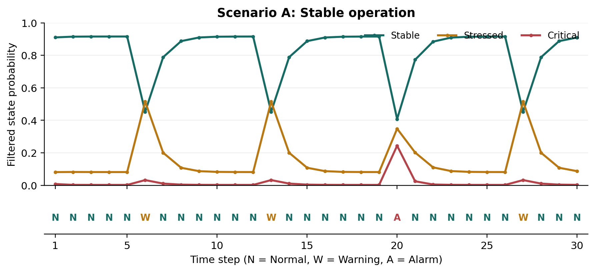
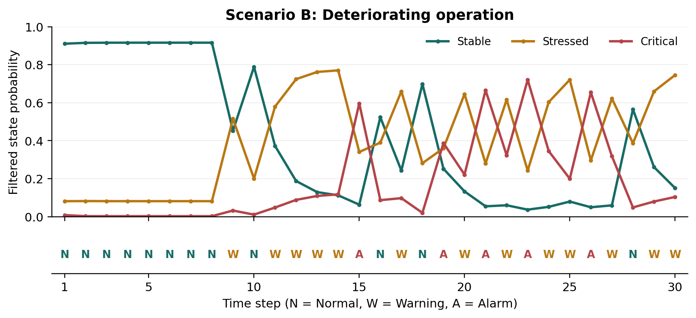
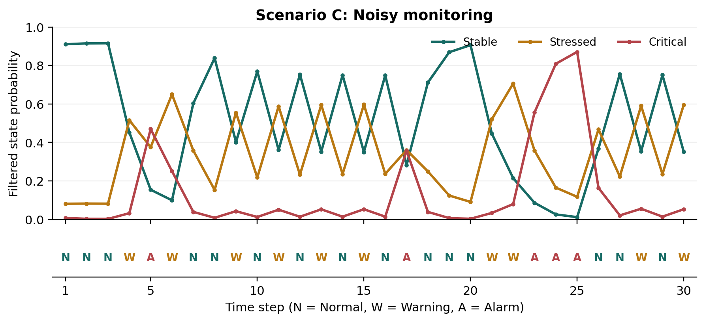
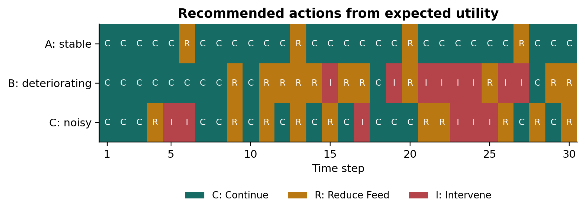
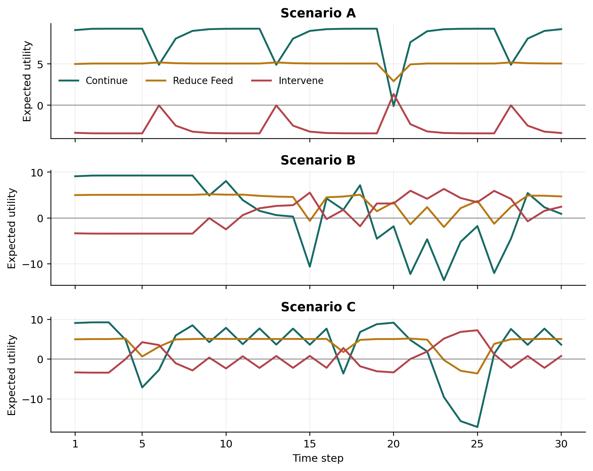

# Biogas Plant Intelligent Monitoring and Decision System

COMP6009 Assignment Part B

## 1. Introduction and problem formulation

An anaerobic digester at a Western Australian red-meat processing facility converts organic waste into useful biogas. Variable waste composition and loading can make its condition difficult to assess. Operators observe sensor readings, while the underlying biological state remains hidden. A warning therefore provides evidence of a problem rather than establishing that the digester is stressed with certainty.

This system represents the hidden state as Stable, Stressed or Critical, and Sensor 1 observations as Normal, Warning or Alarm. Its purpose is to maintain a probability distribution over the states and recommend Continue, Reduce Feed or Intervene. The supplied probability and utility tables define the baseline model [1]. Bayesian inference first investigates individual and combined observations. Hidden Markov Model (HMM) filtering then tracks condition across three 30-step sequences. Finally, expected utility converts each belief distribution into an operational recommendation. Sensitivity experiments examine how modelling choices affect those recommendations. A useful agent must balance maintaining energy production against responding early enough to potentially damaging conditions, while making the basis of each recommendation understandable. The analysis evaluates inference and decision behaviour; the supplied datasets contain no measured hidden states or outcomes with which to establish real-world accuracy.

## 2. Probabilistic modelling and Bayesian inference

The prior probabilities for Stable, Stressed and Critical are 0.70, 0.20 and 0.10. Sensor models specify the probability of an observation given a true state, not the probability of a state given an observation. For example, P(Alarm | Critical) = 0.70 does not mean that an Alarm gives a 70% posterior probability of Critical. The prior and the other states' likelihoods also matter.

For evidence e, Bayesian updating multiplies each prior probability by its likelihood, then divides by their sum. For two sensors, conditional independence permits multiplication of the two likelihoods. The Python function accepts observation-model pairs and performs these operations for any valid labels. It rejects invalid probability tables, unknown observations and evidence having zero model probability.

$$P(x\mid e_1,e_2)=\frac{P(x)P(e_1\mid x)P(e_2\mid x)}{\sum_y P(y)P(e_1\mid y)P(e_2\mid y)}$$

Table 1 reports the single-sensor and combined-sensor posteriors. All distributions use the state order Stable, Stressed, Critical.

| Evidence | Stable | Stressed | Critical |
| --- | ---: | ---: | ---: |
| Normal | 0.910569 | 0.081301 | 0.008130 |
| Warning | 0.420000 | 0.480000 | 0.100000 |
| Alarm | 0.259259 | 0.222222 | 0.518519 |
| Warning + Abnormal pH | 0.114441 | 0.653951 | 0.231608 |

*Table 1. Computed posterior probabilities; displayed values are rounded.*

A Normal reading strongly supports Stable, although it does not eliminate the alternatives. Warning makes Stressed the most likely state, but its 0.48 probability indicates substantial uncertainty. Alarm makes Critical most likely at 0.518519; almost half the probability remains on other states. These results show why the observation label should not be treated as the hidden-state label.

For the manual combined-evidence calculation, the unnormalised weights are shown in Table 2. Their sum is Z = 0.01050 + 0.06000 + 0.02125 = 0.09175. Dividing each weight by Z gives (0.114441, 0.653951, 0.231608), agreeing with Python to the displayed precision. Warning alone similarly gives weights (0.105, 0.120, 0.025), Z = 0.250, and posterior (0.420, 0.480, 0.100).

| State | Prior × Warning likelihood × Abnormal pH likelihood | Weight |
| --- | --- | ---: |
| Stable | 0.70 × 0.15 × 0.10 | 0.01050 |
| Stressed | 0.20 × 0.60 × 0.50 | 0.06000 |
| Critical | 0.10 × 0.25 × 0.85 | 0.02125 |

*Table 2. Manual Bayesian calculation for Warning and Abnormal pH.*

Adding Abnormal pH reduces Stable by 30.56 percentage points and increases Stressed and Critical by 17.40 and 13.16 points. This happens because abnormal pH is substantially more likely in Stressed and Critical than in Stable under the supplied model.

Conditional independence is a strong assumption. If Sensor 1 incorporates pH, multiplying its likelihood by the pH sensor likelihood could double-count overlapping evidence and produce overconfident beliefs. A joint sensor model would be preferable if residual dependence remained after conditioning on state. Also, fixed probabilities may not transfer between plants or remain valid after sensor drift. The three categories compress complex biology: mechanistic digestion models include several biochemical and physicochemical processes [4]. Calibration against independently assessed conditions would be needed before treating these posteriors as reliable operational probabilities.

## 3. HMM-based state estimation

HMM filtering estimates P(X_t | e_1:t), using only observations available at time t. It carries the previous posterior forward through the transition model, incorporates the current likelihood, and normalises. This is forward filtering rather than retrospective smoothing or selection of one most likely complete state sequence [3]. The supplied transition table has current states in rows and next states in columns; its diagonal probabilities, 0.80, 0.60 and 0.65, encode state persistence.

$$\hat b_t(x)=\sum_y b_{t-1}(y)T_{yx},\quad w_t(x)=\hat b_t(x)P(e_t\mid x),\quad b_t(x)=\frac{w_t(x)}{\sum_y w_t(y)}$$

The first observation updates the supplied prior directly, as required by the brief; no transition is applied before it. Thus the first Normal observation gives (0.910569, 0.081301, 0.008130). Transitions begin at step 2. Each scenario starts afresh from the same prior. The pH sensor is excluded from this analysis. Each result row records prediction, unnormalised weights, the normalising constant, posterior, and most probable state.

### Scenario A: stable operation

*Figure 1. Scenario A beliefs and the observed Sensor 1 labels over all 30 steps.*

Scenario A contains 26 Normal readings, three Warnings and one Alarm. At step 5, Stable is 0.916030. The Warning at step 6 moves the belief to (0.452441, 0.515390, 0.032169): Stressed becomes most likely, but the preceding normal history keeps Critical low. Normal at step 7 restores Stable to 0.788846. A second notable change occurs at step 20: Alarm raises Critical from 0.002446 to 0.243657. Stable nevertheless remains the most likely state at 0.407852 because the preceding belief strongly favoured it. Normal at step 21 raises Stable to 0.773248. The final belief assigns 0.910045 to Stable, consistent with the predominantly normal evidence.

### Scenario B: deteriorating operation

*Figure 2. Scenario B beliefs; accumulated Warning and Alarm evidence increases concern.*

Scenario B has 12 Normal readings, 13 Warnings and five Alarms. Warnings from steps 11 to 14 increase Stressed from 0.579738 to 0.770273, indicating accumulating evidence rather than an isolated disturbance. Alarm at step 15 then raises Critical to 0.596112, compared with only 0.243657 after A's step-20 Alarm. The previous stressed belief explains this difference. A further notable change occurs across steps 21 to 23: Alarm, Warning, Alarm produces Critical probabilities 0.665594, 0.323684 and 0.720487. The intervening Warning lowers immediate critical concern without restoring confidence in stability. At step 30, Stressed remains dominant at 0.745404. The sequence therefore supports persistent concern, although its fluctuations do not establish uninterrupted deterioration.

### Scenario C: noisy monitoring

*Figure 3. Scenario C beliefs; alternating readings and an Alarm cluster produce abrupt changes.*

Scenario C contains 15 Normal readings, ten Warnings and five Alarms. At steps 4 and 5, Warning followed by Alarm increases Critical from 0.032197 to 0.470070. Warning at step 6 makes Stressed dominant at 0.650035, while retaining 0.250744 on Critical; Normal at step 7 restores Stable to 0.603187. Another notable change is the consecutive Alarm cluster at steps 23 to 25, which raises Critical from 0.555983 to 0.871110. Normal readings at steps 26 and 27 reduce it to 0.163725 and 0.020711. The noisy scenario produces the highest critical peak, showing that a scenario's name cannot substitute for its actual evidence or ground truth.

Across the scenarios, Stable is most probable on 27 steps in A, 12 in B and 14 in C. A mainly shows short departures from stability; B accumulates evidence of stress; C changes sharply and can briefly appear more critical than B. Identical observation labels can yield different posteriors because their preceding beliefs differ.

The first-order, time-homogeneous HMM assumes that the next state depends only on the current state and that transition probabilities remain fixed. It omits loading history, biological delays and changing operating conditions. It also treats observations as independent across time given the hidden states. Persistent sensor faults could therefore be mistaken for persistent biological deterioration. Since no sampling interval is specified, the transition table should be interpreted per supplied step, not automatically per hour or day.

## 4. Expected-utility decision making

The decision function calculates each action's probability-weighted utility and selects the largest value, following the decision-theoretic agent principle [2]. It uses the full posterior, so a less probable but costly state can influence the recommendation. Utilities are dimensionless scores rather than measured financial returns. Exact ties are resolved by the supplied action order.

$$EU(a\mid b_t)=\sum_x b_t(x)U(a,x),\qquad a_t^*=\arg\max_a EU(a\mid b_t)$$

*Figure 4. All 90 baseline recommendations: C = Continue, R = Reduce Feed, I = Intervene.*

| Scenario | Continue | Reduce Feed | Intervene | Action changes |
| --- | ---: | ---: | ---: | ---: |
| A | 26 | 4 | 0 | 8 |
| B | 11 | 11 | 8 | 13 |
| C | 14 | 10 | 6 | 20 |

*Table 3. Baseline action counts and changes between consecutive recommendations.*

Table 4 highlights three decision points. At A's step 20, Continue has expected utility 10b(Stable) + 2b(Stressed) - 20b(Critical) = -0.097630, using full-precision values before rounding. Reduce Feed gives 2.911923 and Intervene gives 1.363317. Reduce Feed therefore wins although Stable is most probable. The potential loss from continuing under Critical outweighs the benefit of treating the most likely state alone.

| Point | Belief: Stable / Stressed / Critical | EU Continue | EU Reduce | EU Intervene | Choice |
| --- | --- | ---: | ---: | ---: | --- |
| A, t=20 | .407852 / .348491 / .243657 | -0.097630 | 2.911923 | 1.363317 | Reduce Feed |
| B, t=15 | .063245 / .340643 / .596112 | -10.608499 | -0.620476 | 5.537843 | Intervene |
| B, t=22 | .059944 / .616372 / .323684 | -4.641497 | 2.379531 | 4.198812 | Intervene |

*Table 4. Selected beliefs and expected utilities; calculations use unrounded posteriors.*

At B's step 15, Critical becomes dominant and intervention has a clear utility advantage. At step 22, Stressed is most likely, yet Intervene still wins because Critical retains 0.323684 probability after earlier alarms. A simple Stable/Continue, Stressed/Reduce Feed, Critical/Intervene lookup would disagree with expected utility at one step in A, four in B and two in C. It discards uncertainty that remains relevant to the consequences of an action.

The recommendations also reveal operational trade-offs. A favours throughput during normal evidence while temporarily reducing feed during concern. B recommends intervention on eight steps. C changes actions 20 times, which could be disruptive if recommendations directly controlled equipment. Switching costs or minimum action durations could reduce oscillation, but would require a different decision model and careful evaluation of delayed responses.

The baseline assumes fixed utilities and optimises only immediate expected value. Real intervention costs, shutdown consequences and recovery times may vary. Importantly, actions do not alter the supplied transition model. Consequently, a Normal observation following Intervene cannot demonstrate that intervention caused recovery. Evaluating a control policy would require action-dependent transitions, a longer planning horizon and observed outcomes.

### Sensitivity to modelling choices

Three separate experiments retain the same observations and prior. Sensor uncertainty is increased by replacing each likelihood with 0.75 times its baseline value plus 0.25/3. Persistence is increased using T' = 0.5T + 0.5I. Finally, the Continue/Critical utility changes from -20 to -40. All other components remain baseline.

| Separate perturbation | Changed actions: A | B | C |
| --- | ---: | ---: | ---: |
| 25% uniform sensor mixture | 3 | 3 | 4 |
| 50% identity transition mixture | 4 | 4 | 6 |
| Continue/Critical utility -40 | 0 | 1 | 0 |

*Table 5. Recommendations differing from baseline out of 30 steps per scenario.*

Higher persistence removes all four feed reductions in A, but also prolongs some concern in B. These changes illustrate a responsiveness-versus-persistence trade-off, not evidence that the altered model is more accurate. The harsher utility changes B's step 28 from Continue to Reduce Feed without changing its posterior. Probability-model uncertainty and utility uncertainty therefore affect decisions through different mechanisms. These are illustrative sensitivity checks rather than estimated uncertainty intervals or validated alternative plant models.

## 5. Conclusion

The system connects uncertain evidence, sequential state estimation and operational choice in a reproducible pipeline. Bayesian inference distinguishes sensor labels from true conditions: Warning alone gives only 0.48 probability to Stressed, while adding Abnormal pH raises it to 0.653951. HMM filtering preserves observation history, explaining why an Alarm following persistent warnings produces more concern than an Alarm after predominantly normal readings.

The baseline recommends Continue most often in A, more frequent intervention in B, and rapidly changing responses in C. Expected utility improves on a most-probable-state lookup by accounting for costly alternatives that retain meaningful probability. The sensitivity experiments demonstrate that recommendations also depend on sensor reliability, assumed persistence and the consequences assigned to actions. Recording the complete probability vector and all three expected utilities makes these choices auditable: an operator can see whether a recommendation reflects a decisive critical signal or a cautious response to unresolved uncertainty. This transparency is particularly useful when competing actions have similar expected values.

Ten automated checks validate the manual calculations, first-step convention, utility decisions and filtering against independent hidden-path enumeration. However, mathematical correctness does not establish biological calibration or beneficial real-world control. The next practical step would be to assess probabilities and utilities against labelled operating records, investigate sensor dependence, and model how operational actions affect subsequent conditions.

## References

[1] COMP6009, "Assignment Part B: Biogas Plant Intelligent Monitoring and Decision System," supplied assignment brief and scenario datasets, undated.

[2] S. Russell and P. Norvig, "Algorithms from Artificial Intelligence: A Modern Approach," 4th ed., online supplementary material. [Online]. Available: https://aima.cs.berkeley.edu/algorithms.pdf. Accessed: Oct. 13, 2026.

[3] L. R. Rabiner, "A tutorial on hidden Markov models and selected applications in speech recognition," Proceedings of the IEEE, vol. 77, no. 2, pp. 257-286, Feb. 1989, doi: 10.1109/5.18626.

[4] D. J. Batstone et al., "The IWA Anaerobic Digestion Model No 1 (ADM1)," Water Science and Technology, vol. 45, no. 10, pp. 65-73, 2002, doi: 10.2166/wst.2002.0292.

## Appendix A. Baseline model tables

The following tables reproduce the supplied models [1]. Probability rows sum to one. Transition rows refer to current state and columns to next state. Utility rows refer to action and columns to true state.

| True state | Prior | Sensor 1: Normal | Warning | Alarm |
| --- | ---: | ---: | ---: | ---: |
| Stable | 0.70 | 0.80 | 0.15 | 0.05 |
| Stressed | 0.20 | 0.25 | 0.60 | 0.15 |
| Critical | 0.10 | 0.05 | 0.25 | 0.70 |

| True state | Sensor 2: Normal pH | Abnormal pH |
| --- | ---: | ---: |
| Stable | 0.90 | 0.10 |
| Stressed | 0.50 | 0.50 |
| Critical | 0.15 | 0.85 |

| Current → Next | Stable | Stressed | Critical |
| --- | ---: | ---: | ---: |
| Stable | 0.80 | 0.18 | 0.02 |
| Stressed | 0.25 | 0.60 | 0.15 |
| Critical | 0.05 | 0.30 | 0.65 |

| Action | Stable | Stressed | Critical |
| --- | ---: | ---: | ---: |
| Continue | +10 | +2 | -20 |
| Reduce Feed | +5 | +6 | -5 |
| Intervene | -4 | +3 | +8 |

## Appendix B. Additional expected-utility plots

*Figure B1. All three actions' expected utilities over every time step; the highest curve determines the recommendation.*
